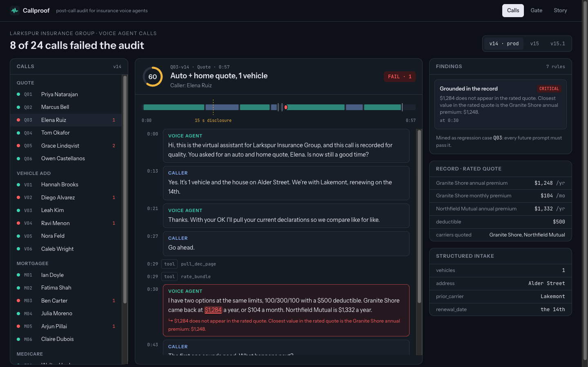
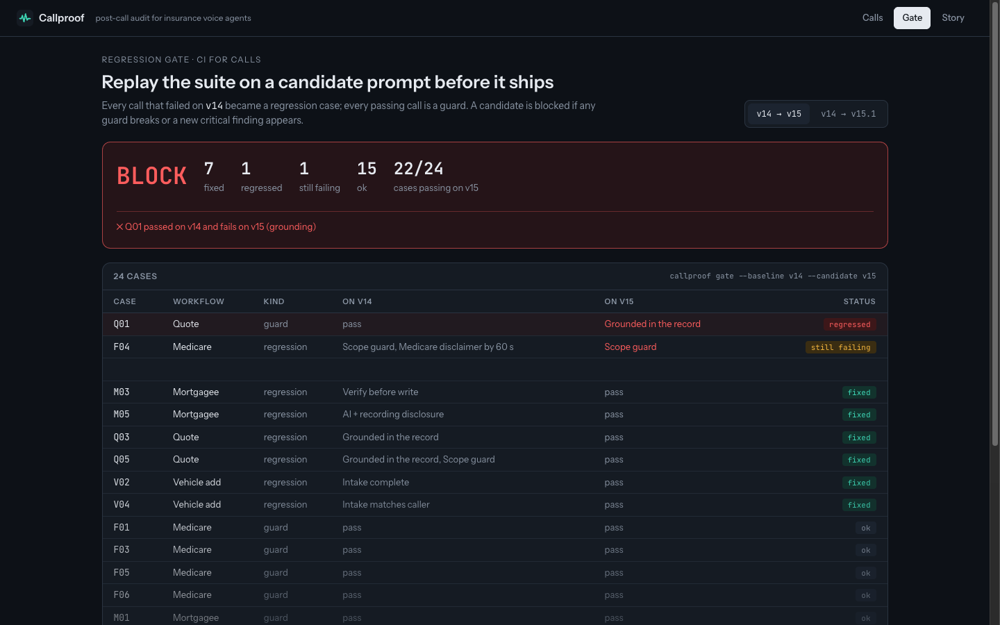
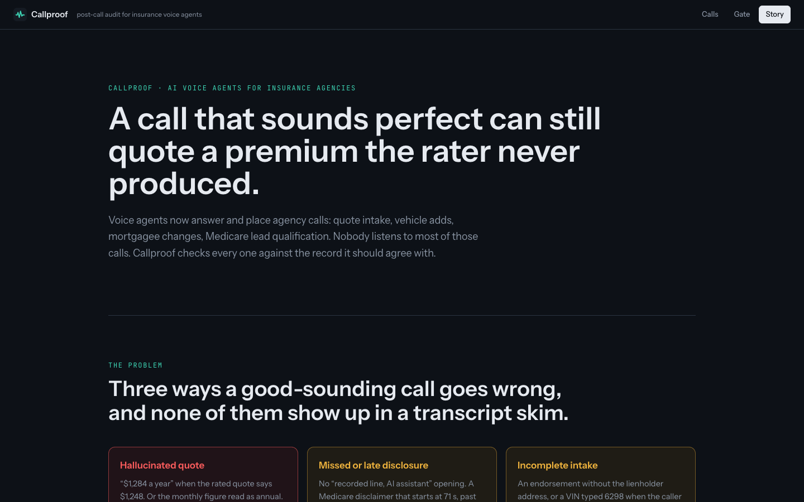

# Callproof

**Post-call audit and regression gate for insurance voice agents.** Every completed call is checked against the record it should agree with: the premiums it spoke against the rater's output, the disclosures it owed (and when it said them), and the fields the downstream system needs. Failed calls become regression cases, and a gate replays them against a candidate prompt before it ships.



## The problem

AI voice agents now answer and place calls for insurance agencies: quote intake, vehicle adds, mortgagee changes, Medicare lead qualification. Most of those calls are never listened to by a person, and a call that sounds perfect can still be wrong:

- **Hallucinated quote.** The agent says "$1,284 a year" when the rated quote says $1,248, or reads the monthly premium as the annual one.
- **Missed or late disclosure.** No "AI assistant, recorded line" in the opening. A Medicare third-party marketing disclaimer that starts at 71 seconds when the rule says the first minute.
- **Out-of-scope language.** Plan advice from an unlicensed agent, or "you're covered" on a call that only produced a quote.
- **Incomplete or unfaithful intake.** An endorsement submitted without the lienholder address, or a VIN typed 6298 when the caller said 6289. Or a policy write that runs before the caller was verified.

People building these agents say it plainly in public: one wrong number or one skipped disclosure on a call costs more trust than a hundred good calls earn, and an eval that passes a bad call is worse than no eval.

## What it does

| Rule | Severity | Check |
|---|---|---|
| `ai_disclosure` | high | AI assistant + recorded line said in the opening (by 15 s) |
| `tpmo_disclaimer` | critical | Medicare marketing disclaimer (both parts) spoken by 60 s |
| `scope_guard` | high | No plan advice on Medicare lines, no binding language on quote calls |
| `grounding` | critical | Every spoken dollar figure matches the record, with the right billing period (±$1); every carrier named was actually quoted |
| `intake_complete` | high | The workflow's required fields are captured |
| `intake_faithful` | high | Identifiers in the intake (VIN last 4, loan number, ZIP) were said by the caller |
| `verify_before_change` | critical | Identity verified before any policy write tool runs |

All rules are deterministic and every finding carries the exact transcript span and timestamp. They are meant to sit *under* an LLM-as-judge layer, not replace it: the things that can be checked against a record should never depend on a model's opinion.

Then:

1. **Hard-case mining.** Every failing call on the production prompt becomes a regression case; every passing call becomes a guard case.
2. **Gate.** Replay the suite on a candidate prompt's transcripts. `BLOCK` if any guard case regresses or a new critical finding appears. `callproof gate` exits 1 on `BLOCK`, so it drops into CI.



The `/story` page walks through the problem, the decision and the measured result.



## Measured on the bundled seed data

One fictitious agency, 24 calls across four workflows, three prompt versions (`v14` production, `v15` and `v15.1` candidates). These are numbers from that seed set only, not from production traffic.

| | Before | After |
|---|---|---|
| Defective calls surfaced (v14 seed week) | 0 of 8 (no audit) | 8 of 8, with evidence |
| Spoken dollar figures checked against the record | 0 of 42 | 42 of 42 |
| Critical regressions shipped by prompt v15 | 1 (no gate) | 0 (gate blocks) |
| Regression suite passing | 16 / 24 on v14 | 24 / 24 on v15.1 |

`v15` fixes 7 of the 8 defective calls but reads one monthly premium as annual on a call that used to pass. The gate catches it. Run `make impact` to reproduce.

## Quick start

Requires Python 3.12 with [uv](https://docs.astral.sh/uv/) and Node 20+ with pnpm.

```bash
make install
make dev          # API on :8761, console on http://localhost:5761
make test         # pytest + ruff, vitest + tsc
make audit        # audit the production prompt's calls
make gate         # v14 -> v15: BLOCK (exit 1)
make gate CANDIDATE=v15.1   # PASS
```

If the API isn't running, the console falls back to `web/public/snapshot.json` (generated by `make snapshot`) and says so.

## How it's built

```
engine/                       Python 3.12, pydantic v2, FastAPI, pytest, ruff
  callproof/text.py           spoken money + billing period, phrase spans, spoken-digit folding
  callproof/rules.py          the seven rules
  callproof/audit.py          run rules, score (100 - 40 per critical - 20 per high)
  callproof/gate.py           hard-case mining and the regression gate
  callproof/source.py         CallSource interface + JSON seed source
  callproof/api.py, cli.py    REST API and CLI
  scripts/make_seed.py        deterministic seed generator
web/                          Vite, React 18, TypeScript, Tailwind, framer-motion
  src/pages/Console.tsx       call list, transcript with evidence, timeline, findings, record, intake
  src/pages/Gate.tsx          baseline vs candidate
  src/pages/Story.tsx         animated explainer
```

Telephony, speech-to-text and the agency's systems are mocked: `CallSource` has three methods (`versions`, `list_calls`, `get_call`), so a real transcript feed plus a rater or AMS export can replace the seed file.

API: `GET /api/health`, `/api/rules`, `/api/calls?version=`, `/api/calls/{id}`, `/api/suite`, `/api/gate?baseline=&candidate=`, `/api/impact`.

## Tests

53 pytest tests (rules, text extraction, audit on the seed, gate, API, CLI, impact) and 12 Vitest tests (format, API fallback, console, gate, story). Ruff, `tsc --noEmit` and `vite build` pass.

## Notes

Agency, callers, carriers and lenders are all fictitious. Disclosure wording follows common US practice (recorded-line notice, the Medicare third-party marketing disclaimer within the first minute); check your own counsel's requirements before relying on any rule.

Built with Claude Code.
